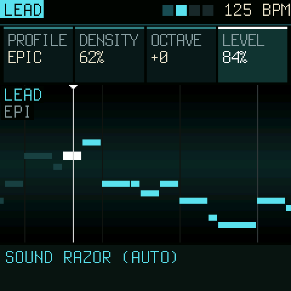
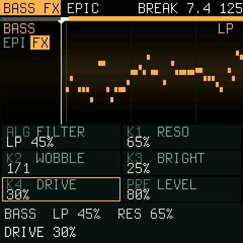
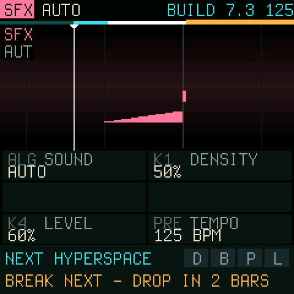

<p align="center"></p>

# Espada

**A generative groovebox for the M-VAVE FM-1, in the style of early-90s PC tracker music.**

Five lanes (lead, pad, bass, drums and sfx) play parts that are composed live from a profile: chords, bass lines,
melodies, drum patterns and noise in the manner of the S3M scene. You do not program steps; you mix styles. Queue the next
profile, blend it in lane by lane from the bottom up, or launch it on the next phrase. Shape each lane with a
filter, a tempo-synced wobble, FM brightness and drive, or with tracker effects: slide, retrigger, a bit crusher and
echo. An arc builds the piece up from the drums to a drop, and DROP lets you call the break yourself.

<p align="center"></p>

> **Status: 0.1, in development.** It boots and runs on the FM-1; playing on the hardware is still being tested.
> Install it over the official firmware and keep the USB rescue in mind (below).

## The screens

Laid out as Tuna is: four cards on top for the four knobs in a row, the music under them, and HOME (or ALGORITHM)
steps from the overview to each channel.

<table>
<tr>
<td align="center" width="33%"><br><b>MAIN</b>: all five lanes. The knobs: the next profile, blend, energy (density for all) and space (the room).</td>
<td align="center" width="33%"><br><b>A channel</b>: its lane large. The knobs: profile, density, octave, level; PRESETS its sound.</td>
<td align="center" width="33%"><br><b>FX</b>: filter, resonance, wobble and drive (FX again: brightness, crush, vary). The screen darkens what the filter cuts.</td>
</tr>
<tr>
<td align="center"><br><b>SFX</b>: noise effects. A riser grows into the drop; the impact lands on it.</td>
<td align="center"><br><b>EDIT</b>: your own part, step by step, in scale steps from the chord root, so it follows the chords.</td>
<td align="center"><br><b>SONG</b>: key, scale and a suggested progression, the chord playing lit.</td>
</tr>
<tr>
<td align="center"><br><b>ARC</b> (off until you turn it on): the energy over the coming bars, build, break, peak and down.</td>
<td colspan="2">

| Control | Does |
| --- | --- |
| SELECT | tempo |
| ALGORITHM, HOME | the channel: MAIN, LEAD, PAD, BASS, DRUMS, SFX |
| PRESETS | the sound (MAIN: the next profile) |
| KNOB 1-4 | the four cards |
| FX / ARP / EDIT / GLO | effects (twice: FX 2), tracker effects, steps, song (twice: the arc) |
| PLAY / SEQ / REC | start-stop, launch on the phrase, DROP (tap or hold) |
| ENV / LFO / SAVE | lock, generate a pattern, save |
| OCT- / OCT+ | the keys' octave |
| Keys | play the channel live; on EDIT they enter steps |

</td>
</tr>
</table>

## How it plays

- **Lanes.** Notes scroll from right to left past a fixed "now" line. Solid blocks are what a lane plays; outlined
  blocks are a preview of the queued profile. HOME steps from the overview (MAIN) to each lane on its own, large,
  with its values on the cards above it, and back. The keys play the channel live; every setting is on a knob.
- **SFX.** The fifth lane: a noise riser into every drop, the impact on it, washes, laser zaps, crackle and 8-bit
  noise, following the arc and the profile.
- **Profiles.** EPIC (orchestral minor), HYPERSPACE (techno minor with power chords), FUSION (melodic major with a
  chromatic turn and a riff that follows the chords), OLDSKOOL (the 4-channel sound with arpeggio chords).
- **Mixing.** BLEND moves lanes to the queued profile one at a time: drums, then bass, pad, lead. LAUNCH moves every
  unlocked lane at the next 4-bar phrase. LOCK keeps a lane where it is. The bass lane's profile sets the chords
  for everyone, so a half-blended mix stays in key.
- **The lead** stays on the harmony: chord tones on every beat, scale runs into them, a motif per phrase that is
  answered and closed. VARY gives each phrase a different character (echo, slide, bite, filter, stutter).
- **Density.** 50 % is the part as the profile writes it. Lower thins it out; higher adds notes inside the chord and
  its scale, 16th hats, ghost snares and fills.
- **DROP.** Tap REC for a break (the channel in view plays alone) that drops on the next phrase with a crash and
  an impact, or hold it and let go when you want the drop. ENERGY on MAIN turns every lane's density up or down at
  once.
- **Stereo and a room.** The voices spread left and right as a tracker's channels do, strings and brass play as
  sections, and a stereo reverb (SPACE) puts it all in a hall.
- **The arc** (off until you turn it on): starts with a few drum hits and builds bass, pad and lead in as the
  energy rises, breaks, drops and builds again.
- **Your own parts.** On the EDIT page you enter notes step by step, tracker style: white keys are scale steps
  counted from the chord root, so a melody follows the chords and stays in key. GENERATE writes a fitting pattern or
  a variation of yours, and never the same one twice.
- **Song.** Key, scale (major, minor, the church modes, harmonic and melodic minor, pentatonics, blues), a list of
  suggested progressions, bars per chord, and the arc's lengths.

The full guide to the panel is in [docs/MANUAL.md](docs/MANUAL.md).

## Install

**[Espada's web installer](https://delirioux.github.io/espada/)** in Chrome or Edge on a computer (it also takes a test
build, and brings back the official V15), the [FM-1 Firmware Hub](https://fm1.designburgapps.com), or from the command
line (once: `pip3 install mido python-rtmidi`):

```
python3 tools/fm1_install.py espada-0.1.fwsc
```

Install over M-VAVE's official firmware. If anything goes wrong: hold **OCT-** while switching on for the USB rescue,
where the installers still reach the FM-1. Installing firmware is at your own risk.

## Build

You need Linux on x86-64 (or macOS / Windows with Docker or WSL), Python 3 with Pillow, JieLi's toolchain and three
files of the JieLi AC79 SDK:

```
pip3 install Pillow
tools/get_toolchain.sh
git clone --depth 1 --branch AC79NN_SDK_V1.2.1_2023-12-13 \
    https://gitee.com/Jieli-Tech/fw-AC79_AIoT_SDK.git ~/fw-AC79_AIoT_SDK
./build.sh                         # -> build/espada.fwsc
./build.sh --release 0.1           # -> build/espada-0.1.fwsc, identity FM-1_961
```

GitHub Actions builds the package on every push (the run's artifact `espada-firmware`).

**Host mode** runs the same code on a computer: `tests/run_host.sh` writes the screens as PNG and the sound as a WAV.
`build/host/espada OUT tests/demo.txt` plays a scripted tour (buttons, encoders, keys over time). The screenshots
above come from host mode, pixel for pixel what the FM-1 draws, at twice the size.

```
firmware/src/espada.c         the app: shared state, includes the parts below
firmware/src/espada_synth.c   the audio interrupt: FM, drum and sfx voices, lane effects, the step clock
firmware/src/espada_music.c   harmony, profiles, generators, density, the arc, your patterns, the bar cache
firmware/src/espada_ui.c      the screen, the views and pages, the panel, saving
firmware/src/platform.c       Dinghy's wiring of the FM-1 platform (boot, USB, updates, panel, screen, settings)
```

The chip's rules ([docs/RULES.md](docs/RULES.md)): integers only, no 64-bit division, the audio interrupt well
under 5.8 ms. SEL + SAVE shows the interrupt's worst time in the header.

## Licence and credits

GPL-3.0-only. Espada is built on [Dinghy](https://github.com/zvenson/dinghy) (zvenson), which carries the platform of
[Felucca](https://github.com/hugelton/Felucca) (Leo Kuroshita, Hügelton Instruments) as
[SLOOP](https://github.com/isod89/sloop-fm1) (isod89) has it. Details in [LICENSING.md](LICENSING.md).

"M-VAVE" and "FM-1" belong to their owners. Espada is not made or endorsed by them.
