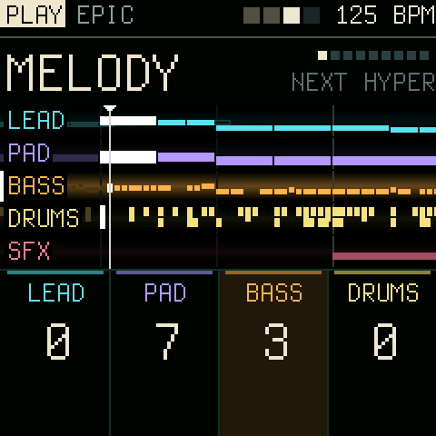
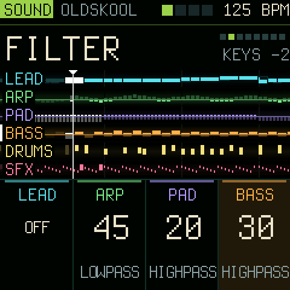
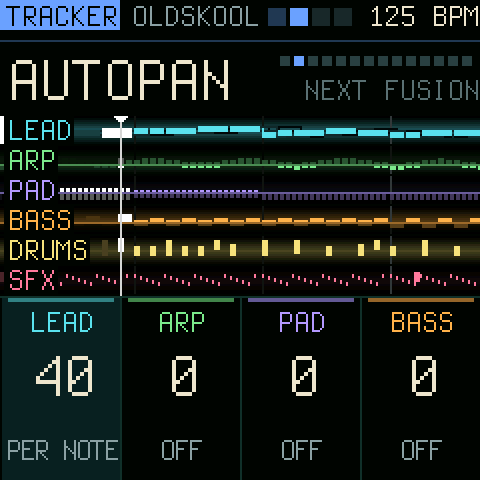
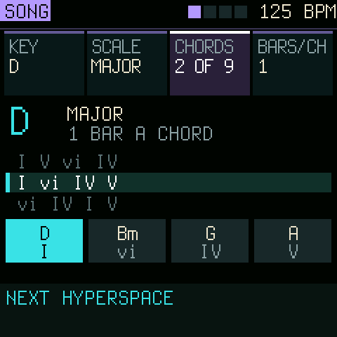
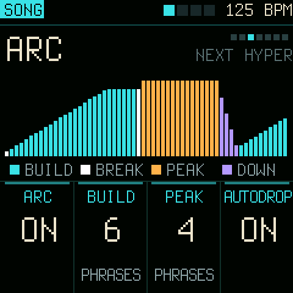
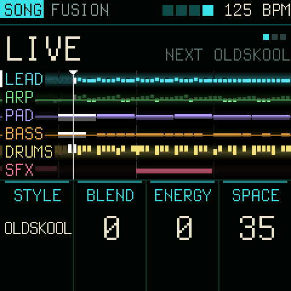
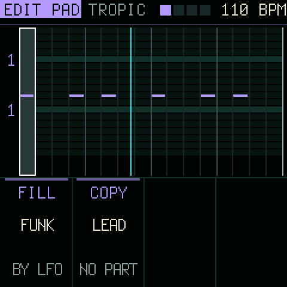
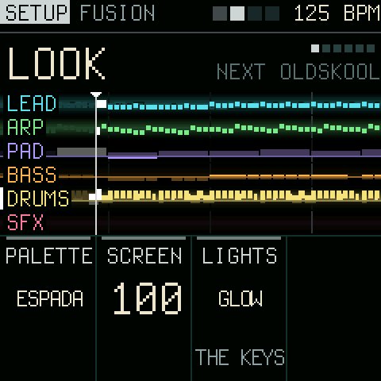
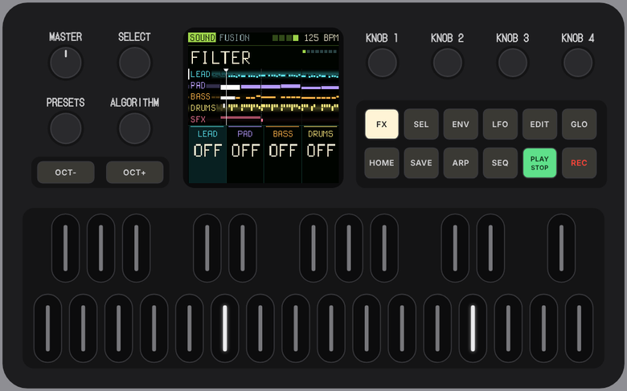

<p align="center"></p>

# Makohai

**A generative groovebox for the M-VAVE FM-1, in the style of early-90s PC tracker music.**

Makohai is Finnish for the longfin mako shark. It was called Espada before 1.0.

Six lanes (lead, arp, pad, bass, drums and sfx) play parts that are composed live in one of ten styles: chords, bass
lines, melodies, drum patterns and noise in the manner of the S3M scene, played as a tracker musician plays them, with
glides, swells and an echo channel. You do not program steps; you mix styles. Queue the next style, blend it in lane by
lane from the bottom up, or launch it at once with its own tempo. Shape each lane with a
filter, a tempo-synced wobble, FM brightness and drive, or with tracker effects: slide, porta, vibrato, tremolo, tremor, gate, swing,
retrigger, a bit crusher, echo, and an equal-power pan per lane with an autopan that sends each note to the other side or sweeps the lane in time. An arc builds the piece up from the drums to a drop, and DROP lets you call the break yourself.

<p align="center"></p>

> **Status: 1.0.** It runs on the FM-1. Long sessions were tested on a computer and in the browser, not yet for hours
> on the hardware: if the sound ever turns to crackles, SETUP's SYSTEM and AUDIO rows show what the FM-1 was doing.
> Install it over the official firmware and keep the USB rescue in mind (below).

## The screens

One screen, laid out as a mixing desk: the setting in large letters on top, all six lanes in the middle, and at the
bottom the four knobs in a row, four lanes side by side, each with its value for that setting; ALGORITHM slides the
window over the six lanes. A group button picks
the kind of setting, PRESETS steps through them.

<table>
<tr>
<td align="center" width="33%"><br><b>PLAY</b> (HOME): volume, style, sound, melody, rhythm, pitch, density, octave, change.</td>
<td align="center" width="33%"><br><b>SOUND</b> (FX): reverb, filter, resonance, wobble, brightness, drive, crush, vary. The lanes darken what the filter cuts.</td>
<td align="center" width="33%"><br><b>TRACKER</b> (ARP): slide, retrigger, rate, echo, porta, vibrato, tremolo, tremor, gate, swing, pan.</td>
</tr>
<tr>
<td align="center"><br><b>SONG</b> (GLO): the knobs are four settings of their own. KEY: key, scale, chords, bars per chord, the chord playing lit.</td>
<td align="center"><br><b>ARC</b> (off until you turn it on): the energy over the coming bars, build, break, peak and down.</td>
<td align="center"><br><b>LIVE</b>: the next of ten styles, blend, energy and space; SEQ launches it at once, with its tempo.</td>
</tr>
<tr>
<td align="center"><br><b>EDIT</b>: the lane's own part, bar by bar, up to 512 bars, in scale steps from the chord root; the drums' nine hits by row. RECORD live, an effect column per step, undo, bar and range tools, FILL a bar from any style, COPY another lane's part; after your last bar: LOOP, PROFILE or MY STYLE (new bars in your manner).</td>
<td align="center"><br><b>SETUP</b> (hold HOME): the palette, the screen's level and the lights; the lanes' MIDI channels; back to defaults.</td>
<td></td>
</tr>
<tr>
<td colspan="3">

| Control | Does |
| --- | --- |
| HOME / FX / ARP / GLO | the groups PLAY, SOUND, TRACKER, SONG; again: the next setting. Hold HOME: SETUP (colours, screen, lights, MIDI channels, defaults) |
| PRESETS | the setting in the group |
| KNOB 1-4 | that setting for the four lanes in the window, LEAD ARP PAD BASS to PAD BASS DRUMS SFX (SONG: the four shown) |
| ALGORITHM | the lane the buttons and keys act on (turning its knob picks it too) |
| SELECT | tempo |
| PLAY / SEQ / REC | INTRO and END, launch the next style (EDIT: copy a lane), INTER (tap) or DROP (hold) |
| ENV / LFO / EDIT | fade the lane out and in (SEL+ENV: lock), a new idea, its steps |
| SAVE, OCT- / OCT+ | save; the keys' octave |
| Keys | play the lane live; on EDIT they enter steps |

</td>
</tr>
</table>

## How it plays

- **Lanes.** Notes scroll from right to left past a fixed "now" line. Solid blocks are what a lane plays; outlined
  blocks are a preview of the queued style. Stopped, the lanes show the INTRO that PLAY will start. All six are
  always on screen; the white mark is the lane the buttons and keys act on. Every setting is on a knob, the keys
  only play.
- **ARP.** Arpeggios through the chord that plays, in each style its own (up, down, up-down, Alberti, broken, random;
  16ths to quarters, 1 to 3 octaves), set on the knobs as every lane.
- **SFX.** The sixth lane: a gale of noise into every drop, the impact on it, washes, surf, laser zaps, crackle and
  8-bit noise, following the arc and the style.
- **Ten styles**, to change the mood in one move: EPIC (orchestral minor), HYPERSPACE (techno minor with power
  chords), FUSION (melodic major with a chromatic turn), OLDSKOOL (the 4-channel sound with arpeggio chords), SYMPHONY
  (the orchestra), TROPIC (off-beat chords, congas, a flute), STEEL (power chords, a galloping bass, double kick),
  DRIFT (sus chords, swells, no snare), FUNK (slap bass, clav, ghost notes) and RAVE (four on the floor, an acid bass).
  Each brings its chords, parts, instruments, tempo and way of playing.
- **Drums.** Kick, snare, hats open and closed, clap, toms that step down in a fill, rim shot, kettle drum and crash,
  in five kits (DEEP: a very low, long kick; PUNCH: the sharp one); each style has its own grooves and fills. SUPERSAW,
  seven detuned saws, for big chords and leads; AH VOX, a choir's aah for the pad; ORCH HIT, the orchestra hit on one
  key, on every drop.
- **Sets.** Eight sets of everything but your parts (styles, knobs, mutes, key, tempo, effects), to load at once while
  playing (SONG, SETS).
- **Played by hand.** Lead notes glide in from the last one, long chords swell in or fade out, the lead has an echo
  channel, as in the trackers; strings carry bow noise and the drums ring as recorded ones. Each style also plays the
  tracker's effects its own way: vibrato, slides, dives, cut-off stabs, volume slides, swing, trance gates, wide
  stereo and orchestra hits.
- **The music of a lane.** MELODY (which idea), RHYTHM, PITCH and CHANGE (how soon new material comes, from frozen
  to every 16 bars), side by side for all four lanes. LFO: a new idea now. ENV fades a lane out and in.
- **Long arcs.** The lead plays 16-bar sections of two 8-bar periods: a motif stated, answered, sequenced, closed
  open, then driven to its high point and closed on the root.
- **Mixing.** BLEND moves lanes to the queued style one at a time: drums, then bass, pad, lead. LAUNCH moves every
  unlocked lane at the next 4-bar phrase. LOCK keeps a lane where it is. The bass lane's style sets the chords
  for everyone, so a half-blended mix stays in key.
- **The lead** stays on the harmony: chord tones on every beat, scale runs into them, a motif per phrase that is
  answered and closed. VARY gives each phrase a different character (echo, slide, bite, filter, stutter).
- **Density.** 50 % is the part as the style writes it. Lower thins it out; higher adds notes inside the chord and
  its scale, 16th hats, ghost snares and fills.
- **Song form.** PLAY starts with an INTRO: pad, drums or bass alone, the other lanes in one by one. A tap on REC
  is an INTER: one lane alone for two bars, the others back one by one. Holding REC is a DROP: one lane alone while
  you hold, everything back with a crash the moment you let go. PLAY again is the END: the lanes fade out one by
  one, bass or drums last, and Makohai stops. ENERGY (SONG) turns every lane's density up or down at
  once.
- **Stereo and a room.** The voices spread left and right as a tracker's channels do, strings and brass play as
  sections, and a stereo reverb (SPACE) puts it all in a hall.
- **The arc** (off until you turn it on): starts with a few drum hits and builds bass, pad and lead in as the
  energy rises, breaks, drops and builds again.
- **Your own parts.** On the EDIT page you enter notes step by step, tracker style: white keys are scale steps
  counted from the chord root, so a melody follows the chords and stays in key. A part is as long as you write it, up
  to 512 bars a lane. FILL writes a bar in any of the ten styles, or a variation of yours, never the same one twice;
  REPEAT copies the bar before; COPY takes another lane's part (a lead line becomes a bass line in the same chords).
  RECORD what you play, live, into the part; a tracker's effect column per step (volume, slide, porta up and down,
  vibrato, retrigger, cut, delay); undo, transpose, shift, bars in and out, copy and paste a range of bars. On PAD a
  key plays a chord in key.
  After your last bar the part loops, gives way to the generated one, or goes on in your style: MY STYLE learns the
  rhythms and jumps of your bars and writes new ones like them.
- **Song.** Key, scale (major, minor, the church modes, harmonic and melodic minor, pentatonics, blues), a list of
  suggested progressions, bars per chord, and the arc's lengths.

The full guide to the panel is in [docs/MANUAL.md](docs/MANUAL.md). Where Makohai is going, how it is built and
why: [docs/DEVELOPMENT.md](docs/DEVELOPMENT.md).

## Try it in the browser

<p align="center"><a href="https://delirioux.github.io/makohai/try/"></a></p>

**[Makohai in the browser](https://delirioux.github.io/makohai/try/)**: the same code the FM-1 runs, compiled to
WebAssembly, on Felucca's browser FM-1 (knobs, buttons, keys; your computer's keyboard plays it too, a MIDI
controller turns the knobs). Chrome, Edge, Firefox or Safari.

## Install

**[Makohai's web installer](https://delirioux.github.io/makohai/)** in Chrome or Edge on a computer (it also takes a test
build, and brings back the official V15), the [FM-1 Firmware Hub](https://fm1.designburgapps.com), or from the command
line (once: `pip3 install mido python-rtmidi`):

```
python3 tools/fm1_install.py makohai-1.0.fwsc
```

Install over M-VAVE's official firmware. If anything goes wrong: hold **OCT-** while switching on for the USB rescue,
where the installers still reach the FM-1. Installing firmware is at your own risk.

## Build

You need Linux on x86-64 (or macOS / Windows with Docker or WSL), Python 3 with Pillow, JieLi's toolchain and three
files of the JieLi AC79 SDK:

```
pip3 install Pillow
tools/get_toolchain.sh
git clone --depth 1 --branch AC79NN_SDK_V1.2.1_2023-12-13 \
    https://gitee.com/Jieli-Tech/fw-AC79_AIoT_SDK.git ~/fw-AC79_AIoT_SDK
./build.sh                         # -> build/makohai.fwsc
./build.sh --release 1.0           # -> build/makohai-1.0.fwsc, identity FM-1_961
```

GitHub Actions builds the package on every push (the run's artifact `makohai-firmware`).

**In the browser:** `web/emu/makohai_build.sh` (clang with wasm-ld, or Emscripten) writes `build/makohai_emu/`;
serve that folder and open it. `node web/emu/makohai_emu_test.mjs build/makohai_emu/makohai.wasm` checks it without
a browser.

**Host mode** runs the same code on a computer: `tests/run_host.sh` writes the screens as PNG and the sound as a WAV.
`build/host/makohai OUT tests/demo.txt` plays a scripted tour (buttons, encoders, keys over time). The screenshots
above come from host mode, pixel for pixel what the FM-1 draws, at twice the size.

```
firmware/src/makohai.c         the app: shared state, includes the parts below
firmware/src/makohai_synth.c   the audio interrupt: FM, drum and sfx voices, lane effects, the step clock
firmware/src/makohai_music.c   harmony, the ten styles, generators, density, the arc, your patterns, the bar cache
firmware/src/makohai_ui.c      the screen, the views and pages, the panel, saving
firmware/src/platform.c       Dinghy's wiring of the FM-1 platform (boot, USB, updates, panel, screen, settings)
```

The chip's rules ([docs/RULES.md](docs/RULES.md)): integers only, no 64-bit division, the audio interrupt well
under 5.8 ms. SEL + SAVE shows the interrupt's worst time in the header.

## Licence and credits

GPL-3.0-only. Makohai is built on [Dinghy](https://github.com/zvenson/dinghy) (zvenson), which carries the platform of
[Felucca](https://github.com/hugelton/Felucca) (Leo Kuroshita, Hügelton Instruments) as
[SLOOP](https://github.com/isod89/sloop-fm1) (isod89) has it. Details in [LICENSING.md](LICENSING.md).

"M-VAVE" and "FM-1" belong to their owners. Makohai is not made or endorsed by them.
