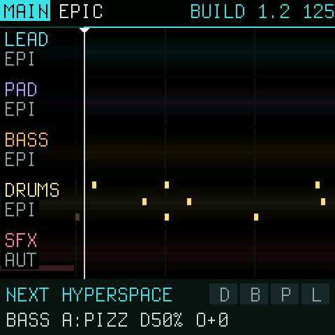

<p align="center"></p>

# Espada

**A generative groovebox for the M-VAVE FM-1, in the style of early-90s PC tracker music.**

Five lanes (lead, pad, bass, drums and sfx) play parts that are composed live from a profile: chords, bass lines,
melodies, drum patterns and noise in the manner of the S3M scene. You do not program steps; you mix styles. Queue the next
profile, blend it in lane by lane from the bottom up, or launch it on the next phrase. Shape each lane with a
filter, a tempo-synced wobble, FM brightness and drive, or with tracker effects: slide, retrigger, a bit crusher and
echo. An arc builds the piece up from the drums to a drop, and DROP lets you call the break yourself.

<p align="center"></p>

> **Status: 0.1, first version.** Runs in host mode (screen and sound on a computer). Not yet confirmed on an FM-1:
> install it over the official firmware and keep the USB rescue in mind (below).

## How it plays

- **Lanes.** Notes scroll from right to left past a fixed "now" line. Solid blocks are what a lane plays; outlined
  blocks are a preview of the queued profile. HOME steps from the overview (MAIN) to each lane on its own, large,
  with its values written out, and back.
- **SFX.** The fifth lane: a noise riser into every drop, the impact on it, washes, laser zaps, crackle and 8-bit
  noise, following the arc and the profile.
- **Profiles.** EPIC (orchestral minor), HYPERSPACE (techno minor with power chords), FUSION (melodic major with a
  chromatic turn and a riff that follows the chords), OLDSKOOL (the 4-channel sound with arpeggio chords).
- **Mixing.** BLEND moves lanes to the queued profile one at a time: drums, then bass, pad, lead. LAUNCH moves every
  unlocked lane at the next 4-bar phrase. LOCK keeps a lane where it is. The bass lane's profile sets the chords
  for everyone, so a half-blended mix stays in key.
- **Density.** 50 % is the part as the profile writes it. Lower thins it out; higher adds notes inside the chord and
  its scale, 16th hats, ghost snares and fills.
- **The arc.** Starts with a few drum hits and builds: bass, pad and lead come in as the energy rises. When it tops
  out, one lane plays alone for a bar and then everything drops back in with a crash. After the peak it falls back
  and builds again. DROP: tap for a break that ends on the next phrase, or hold it and let go when you want the drop.
- **Your own parts.** On the EDIT page you enter notes step by step, tracker style: white keys are scale steps
  counted from the chord root, so a melody follows the chords and stays in key. GENERATE writes a fitting pattern or
  a variation of yours, and never the same one twice.
- **Song.** Key, scale (major, minor, the church modes, harmonic and melodic minor, pentatonics, blues), a list of
  suggested progressions, bars per chord, and the arc's lengths.

The full guide to the panel is in [docs/MANUAL.md](docs/MANUAL.md).

## Install

**[Espada's web installer](https://delirioux.github.io/espada/)** in Chrome or Edge on a computer (it also takes a test
build, and brings back the official V15), the [FM-1 Firmware Hub](https://fm1.designburgapps.com), or from the command
line (once: `pip3 install mido python-rtmidi`):

```
python3 tools/fm1_install.py espada-0.1.fwsc
```

Install over M-VAVE's official firmware. If anything goes wrong: hold **OCT-** while switching on for the USB rescue,
where the installers still reach the FM-1. Installing firmware is at your own risk.

## Build

You need Linux on x86-64 (or macOS / Windows with Docker or WSL), Python 3 with Pillow, JieLi's toolchain and three
files of the JieLi AC79 SDK:

```
pip3 install Pillow
tools/get_toolchain.sh
git clone --depth 1 --branch AC79NN_SDK_V1.2.1_2023-12-13 \
    https://gitee.com/Jieli-Tech/fw-AC79_AIoT_SDK.git ~/fw-AC79_AIoT_SDK
./build.sh                         # -> build/espada.fwsc
./build.sh --release 0.1           # -> build/espada-0.1.fwsc, identity FM-1_961
```

GitHub Actions builds the package on every push (the run's artifact `espada-firmware`).

**Host mode** runs the same code on a computer: `tests/run_host.sh` writes the screens as PNG and the sound as a WAV.
`build/host/espada OUT tests/demo.txt` plays a scripted tour (buttons, encoders, keys over time).

```
firmware/src/espada.c         the app: shared state, includes the parts below
firmware/src/espada_synth.c   the audio interrupt: FM and drum voices, lane effects, the step clock
firmware/src/espada_music.c   harmony, profiles, generators, density, the arc, your patterns, the bar cache
firmware/src/espada_ui.c      the screen, the pages, the panel, saving
firmware/src/platform.c       Dinghy's wiring of the FM-1 platform (boot, USB, updates, panel, screen, settings)
```

The chip's rules ([docs/RULES.md](docs/RULES.md)): integers only, no 64-bit division, the audio interrupt well
under 5.8 ms. SEL + SAVE shows the interrupt's worst time on the screen.

## Licence and credits

GPL-3.0-only. Espada is built on [Dinghy](https://github.com/zvenson/dinghy) (zvenson), which carries the platform of
[Felucca](https://github.com/hugelton/Felucca) (Leo Kuroshita, Hügelton Instruments) as
[SLOOP](https://github.com/isod89/sloop-fm1) (isod89) has it. Details in [LICENSING.md](LICENSING.md).

"M-VAVE" and "FM-1" belong to their owners. Espada is not made or endorsed by them.
